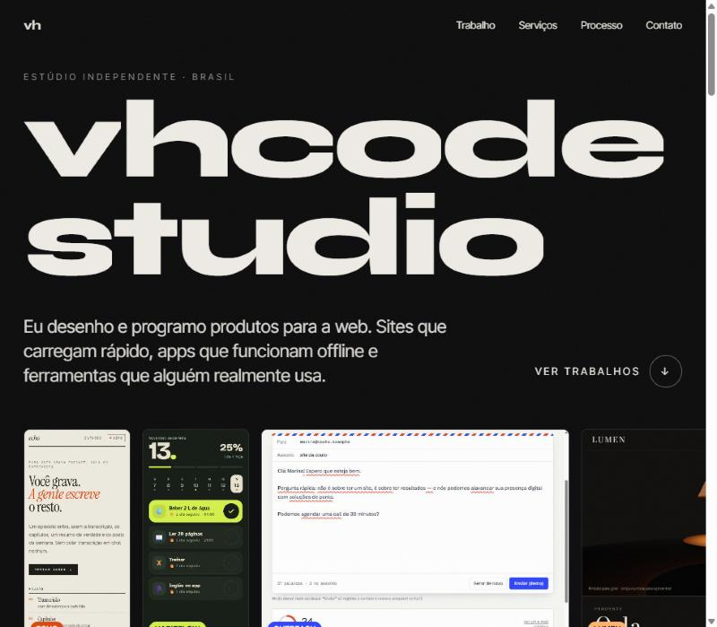

# vhcodestudio

**PT** · Site do estúdio: hero com animação, estudos de caso de todos os projetos (com link ao vivo e código), serviços, processo e contato.
**EN** · Studio website: animated hero, case studies for every project (live links and source), services, process and contact.

🔗 **Ao vivo / Live:** https://vhcodestudio.vercel.app



## Português

### Destaques
- **Hero:** o nome sobe letra por letra por trás de uma máscara e uma faixa com telas reais dos projetos desliza na horizontal conforme a página rola (`useScroll` + `useTransform` do Motion)
- **Estudos de caso:** cada projeto ocupa o palco com a própria cor ao passar o mouse ou focar pelo teclado; ao abrir, mostra problema, solução, detalhe técnico, stack e links
- Respeita `prefers-reduced-motion`: sem deslocamentos, só opacidade
- Textos revisados para não soarem genéricos
- Dados dos projetos em `src/lib/projects.ts`, com testes que conferem links, imagens e estilo do texto

### Stack
Next.js 16 · React 19 · TypeScript · Tailwind CSS 4 · Motion · Vitest

### Como rodar
```bash
npm install
npm run dev
npm test
npm run build
```

## English

Studio site with a masked letter-by-letter hero, a scroll-linked film strip of real project screens, and expandable case studies where each project takes over the stage in its own color. Reduced-motion aware. Project data is typed and tested.
